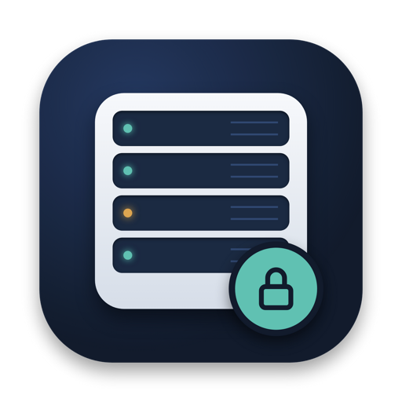
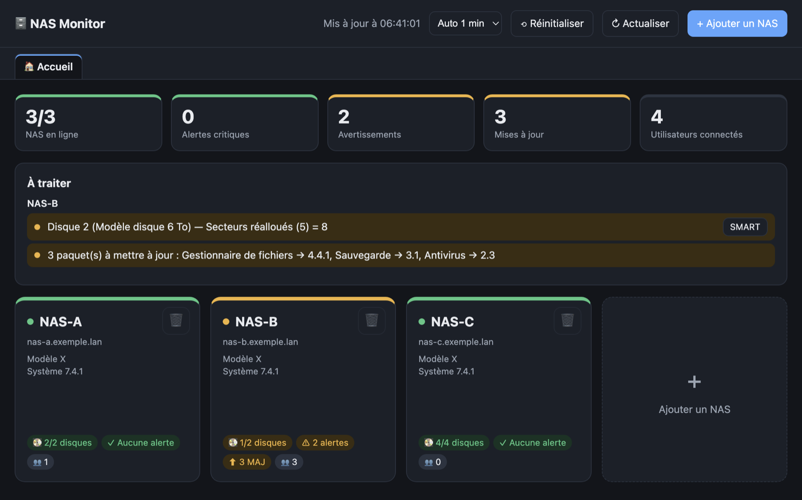
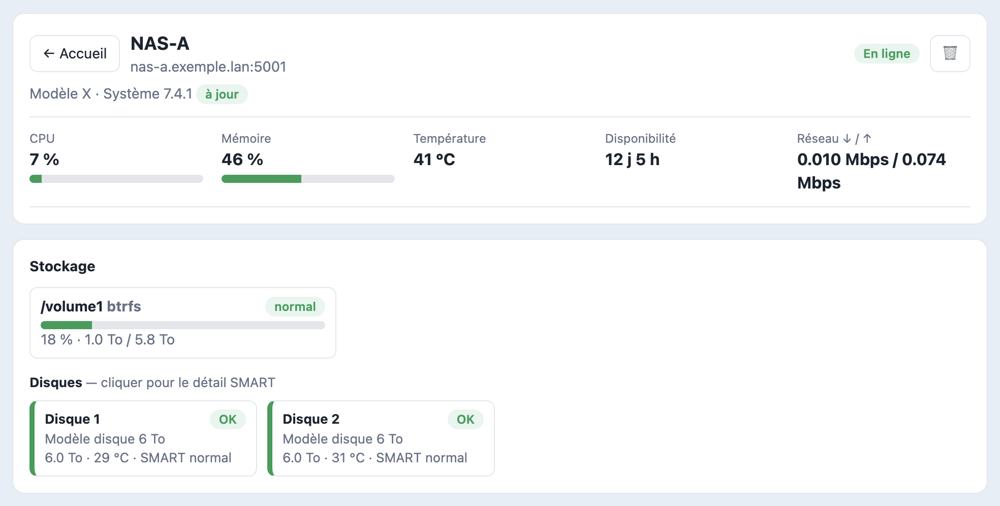
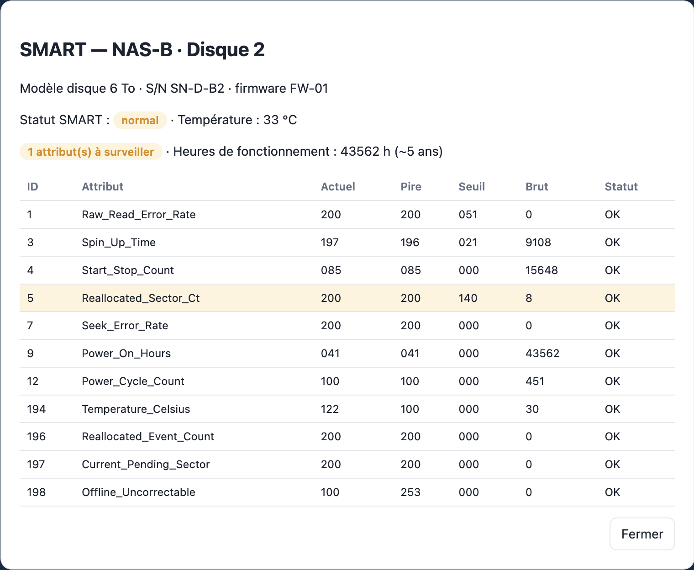

<p align="center"></p>

# NAS Monitor

Application macOS qui **supervise plusieurs NAS depuis un seul écran** : état du système, volumes, disques avec **alertes SMART**, mises à jour, paquets et utilisateurs connectés.

<p align="center">
  <br><br>
  <br><br>
  
</p>

*Captures avec des données fictives.*

## Télécharger

➡️ **[NAS-Monitor.dmg](https://github.com/mx-ch-rgb/NAS-Monitor/releases/latest/download/NAS-Monitor.dmg)** (dernière version)

Application signée (Developer ID) et notarisée par Apple. Ouvrez le DMG, glissez NAS Monitor dans Applications, lancez-la.

**Prérequis :** Mac Apple Silicon (testée sous macOS 27.2).

Intégrité du fichier (SHA-256), à comparer avec `shasum -a 256 NAS-Monitor.dmg` :

```
44432261d3f594494186fa732a876b4c26cd9e5b62bf679ea77c832b98cfcb48  NAS-Monitor.dmg
```

## Ce que l'app fait

- **Accueil** : un bandeau de synthèse (NAS en ligne, alertes, mises à jour, connectés), la liste des alertes à traiter et une tuile carrée par NAS, verte, orange ou rouge.
- **Un onglet par NAS** : processeur, mémoire, température, réseau, volumes, disques, utilisateurs connectés avec leur protocole, paquets et mises à jour disponibles.
- **Alertes SMART automatiques** : les attributs de chaque disque sont lus à chaque rafraîchissement (toutes les minutes par défaut).

| Attribut SMART surveillé | Niveau si la valeur brute est supérieure à 0 |
|---|---|
| 5 · 10 · 187 · 196 (secteurs réalloués, relances, erreurs non corrigées, réallocations) | Attention |
| 197 · 198 (secteurs en attente, non corrigibles) | Critique |

Un statut d'attribut autre que « OK » est aussi signalé comme critique, et une température de 60 °C ou plus déclenche une alerte.

## Sécurité

- **Mot de passe maître** exigé dès le premier lancement : 12 caractères avec 3 types (minuscules, majuscules, chiffres, symboles), ou une phrase de 20 caractères. Il ne peut pas être récupéré ; en cas d'oubli, le coffre se réinitialise et les NAS sont à rajouter.
- **Coffre chiffré** (AES-256-GCM, clé dérivée par scrypt) : les identifiants des NAS ne sont jamais stockés en clair.
- **Accès local uniquement** : le serveur intégré n'écoute que sur `127.0.0.1` et exige un jeton aléatoire, renouvelé à chaque déverrouillage.
- **Verrouillage automatique** : raccourci ⌘L, verrouillage de l'écran, mise en veille, ou 30 minutes d'inactivité. Un délai croissant s'applique après 3 mots de passe erronés.
- **Double authentification (MFA) recommandée** sur chaque NAS, sans être obligatoire : l'app la prend en charge avec un jeton d'appareil de confiance.
- **Un compte dédié par NAS** est conseillé pour isoler les accès (les droits d'administrateur sont généralement nécessaires pour lire l'état des disques).

## Ajouter un NAS

Bouton **+ Ajouter un NAS** : adresse (IP, nom DNS ou URL collée), port (facultatif), HTTPS (recommandé), identifiant et mot de passe, puis le code de double authentification si le compte l'exige.

## À savoir

- Projet **indépendant**, non affilié à un fabricant de NAS. Les noms de produits et marques appartiennent à leurs propriétaires.
- Certaines API interrogées ne sont pas documentées officiellement : elles peuvent changer d'une version du système à l'autre, sans garantie.
- Les certificats auto-signés sont acceptés sans vérification : à réserver à vos propres appareils.
- Compatible avec les NAS dont l'API web est accessible via `/webapi/entry.cgi`.

## Auteur

© 2026 Marc Christiaens. Distribué tel quel, sans garantie, pour un usage personnel.
